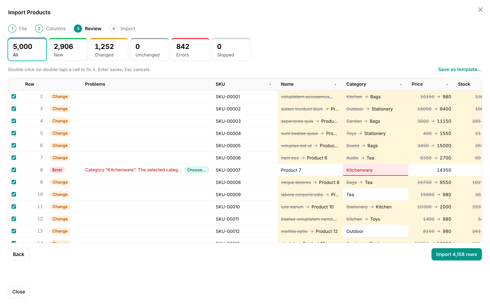
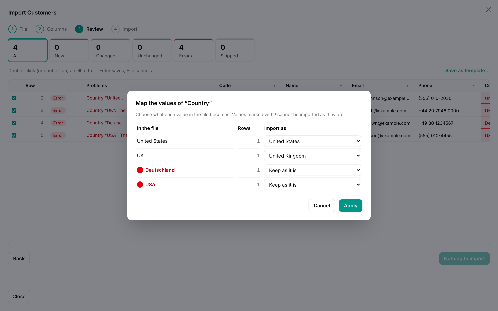
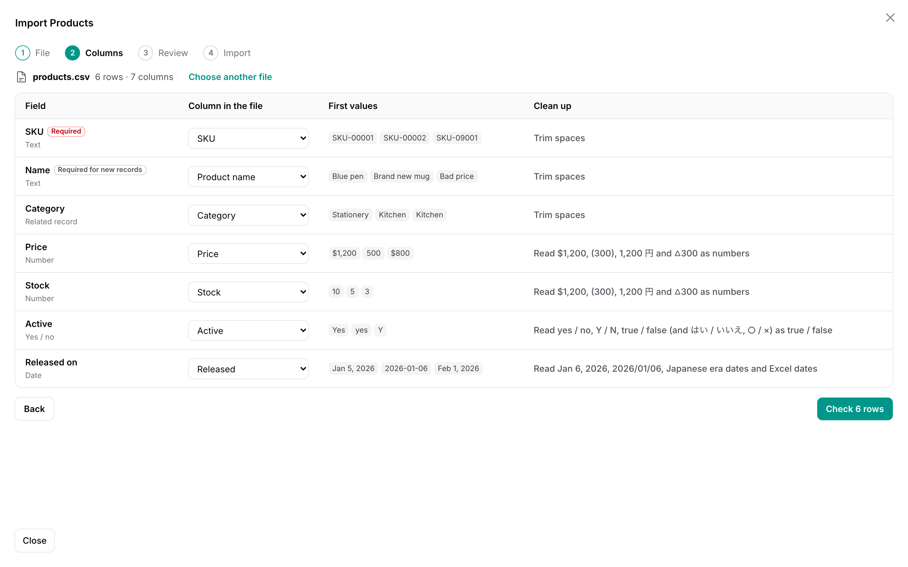
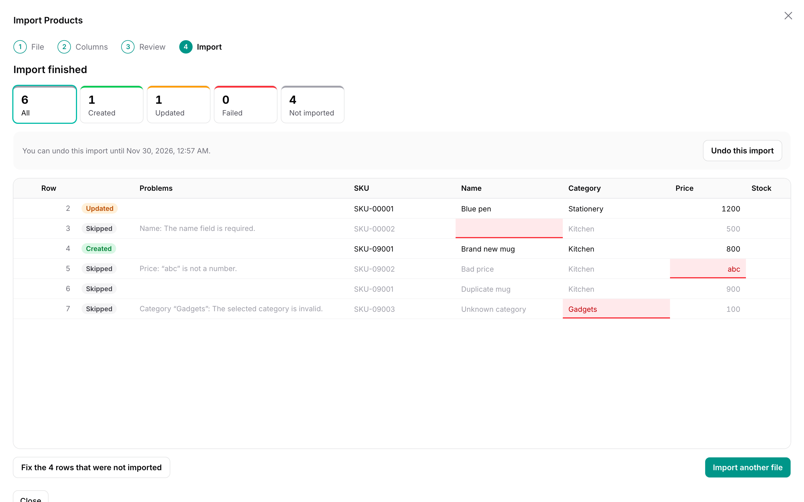
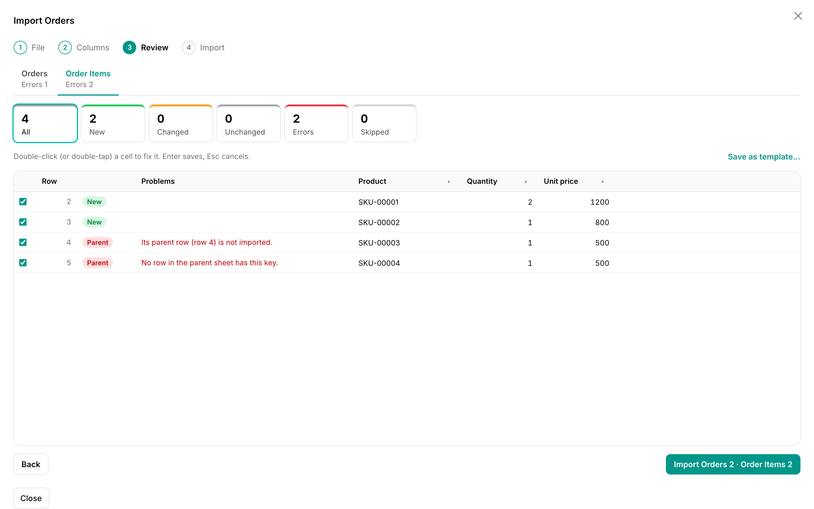

# Warp Import



**Import CSV and Excel files into Filament with the `Importer` classes you already have — and see every row, every change and every error before anything is written. Fix mistakes in place, import 100,000 rows without a queue worker, and undo an import with one click.**

<a href="https://demo.warpui.com/import"></a>

Drop a spreadsheet of products, customers or orders with their items, review what would be created and changed, fix the errors and import — then undo it — at **[demo.warpui.com/import](https://demo.warpui.com/import)**. No sign-up needed; the data is reset every hour.

Filament's own `ImportAction` takes a CSV file, hands it to a queue and tells you afterwards how many rows failed, in a CSV of failed rows. Warp Import keeps your `Importer` and changes everything around it. The file is read in the browser. Every row runs through your importer *without saving*, so users see which rows will be new, which will change and how, and which have errors, before anything happens. They fix cells in a table, map "東京都" or "Sold out" to the values your app expects, and import. If something went wrong anyway, they undo the import: created records are deleted and changed ones get their old values back.

```php
use App\Filament\Imports\ProductImporter;
use Qalainau\FilamentWarpImport\Actions\WarpImportAction;

protected function getHeaderActions(): array
{
    return [
        // was: ImportAction::make()->importer(ProductImporter::class)
        WarpImportAction::make()->importer(ProductImporter::class),
    ];
}
```

## Contents

- [Why](#why)
- [Features](#features)
- [Requirements](#requirements)
- [Installation](#installation)
- [Usage](#usage)
- [How rows are checked](#how-rows-are-checked)
- [Images and files](#images-and-files)
- [Approval](#approval)
- [Scheduled imports](#scheduled-imports)
- [Records that are not in the file](#records-that-are-not-in-the-file)
- [Updating existing records](#updating-existing-records)
- [Clean-up and value mapping](#clean-up-and-value-mapping)
- [AI suggestions](#ai-suggestions)
- [Importing and undoing](#importing-and-undoing)
- [Parent and child sheets](#parent-and-child-sheets)
- [Templates](#templates)
- [Import history](#import-history)
- [Testing](#testing)
- [Multi-tenancy](#multi-tenancy)
- [Security](#security)
- [Limitations](#limitations)

## Why

Measured on the server (checking, writing and undoing; the browser adds the time to send the rows), importing products through a plain Filament importer with a relationship, a number, a boolean and a date column — 2,000 rows update existing products, the rest are new:

| | SQLite | MySQL 8.4 | PostgreSQL 18 |
| --- | --- | --- | --- |
| Check 10,000 rows | 3.6 s | 6.2 s | 6.9 s |
| Import 10,000 rows | 6.1 s | 8.4 s | 9.7 s |
| Undo 10,000 rows | 1.8 s | 2.5 s | 2.5 s |
| Check 100,000 rows | 43 s | 57 s | 65 s |
| Import 100,000 rows | 63 s | 95 s | 103 s |
| Undo 100,000 rows | 18 s | 33 s | 28 s |

On a laptop (Apple M4 Max, PHP 8.4, one PHP process). The work is done in steps of 500 to 1,000 rows, so memory stays flat however large the file is.

There is no queue worker to set up: the browser sends the work in small steps and shows the progress. Users can pause and resume, and an import interrupted by a closed tab continues from the history.

## Features



- **Your Filament importers, unchanged**: columns, `rules()`, `relationship()`, `castStateUsing()`, `fillRecordUsing()`, `resolveRecord()`, the hooks (`beforeSave()` and so on), `getOptionsFormComponents()` and `getCompletedNotificationBody()` all work as with `ImportAction`.
- **CSV, TSV, Excel and pasted cells**: `.csv`, `.tsv` and `.xlsx`; UTF-8, or the encoding Excel saves CSV in for its language — Windows-1252 (Western Europe and the Americas), Shift_JIS, Korean CP949, Chinese GBK or Big5 — told apart from the file, with an **Encoding** menu in case letters look wrong; every sheet of a workbook, Excel dates as dates. Or paste a block of cells from Excel or Google Sheets. Files are read in the browser and never uploaded.
- **Column mapping** guessed from your column names, labels and `guess()`, ignoring case, width and separators, with the first values of each column next to it.
- **Review before writing**: every row is new, changed (with the old and new value of each field, related records by name), unchanged or an error. Rows that point at the same record are flagged. Filter by outcome and scroll through 100,000 rows.
- **Fix in place**: double-click a cell (double-tap on a phone or tablet, or press Enter) to change the value from the file and the row is checked again. Skip single rows or every row with an error. Find and replace in a column.
- **Clean-up** per column: trim, numbers like `$1,200` and `(300)`, dates like `Oct 20, 2026`, `2026/10/20` and Excel serials, yes/no like `Y` / `N` — European files with decimal commas (`1.234,56 €`), `31.12.2026`, `31/12/2026` and month names in German, French, Spanish, Italian and Portuguese — and the Japanese forms too: full-width digits, `１，２００円`, `△300`, `令和8年10月20日`, はい／いいえ and ○／×, postal codes and phone numbers. Numbers, dates and yes/no values that Filament would silently turn into `0` or `true` become errors instead.
- **AI suggestions** (optional): **Suggest with AI** maps headers like "Client ID" or "Mail" and values like "England" or "VIP" with Claude — you check them before anything is imported.
- **Value mapping**: the different values of a column with their row counts, unknown values first, mapped to the column's options (enums, `in` rules), related records or yes/no, with suggestions. An invalid value in the review has a **Choose…** button that opens it.
- **Undo** for 30 days: created records are deleted, changed ones get their old values back. Records someone changed after the import are kept and listed.
- **Parent and child sheets**: orders and their items, in two sheets of one workbook, in one import.
- **Templates**: save the mapping, clean-up and value mapping; files with the same headers get them automatically next time.
- **Images and files**: photos and documents from links or a ZIP, put on a Laravel disk when the row is written, removed again on undo.
- **Approval**: one person prepares the import, another reviews the same changes and approves or sends it back.
- **Scheduled imports**: import a supplier's price list from a link, a Google Sheets spreadsheet or storage every hour, day or week, with the same columns and clean-up; rows with errors stop the run and notify you.
- **Sync with a full list**: optionally delete or deactivate the records a file leaves out — listed in the review, confirmed before writing, undone with the rest.
- **Results**: created, updated and failed rows. Rows that were not imported (skipped, errors, failed) can be fixed right there and imported into the same import, or downloaded as a CSV with the reasons.
- **History** of imports to reopen, resume, undo or download them as imported, and `->queue()` for imports you would rather run in the background.
- Light and dark mode, keyboard navigation, translations (English, Japanese, German, French, Spanish, Italian, Brazilian Portuguese, Korean and Chinese, simplified and traditional), and Filament's [multi-tenancy](#multi-tenancy).

## Requirements

- PHP 8.3+
- Laravel 12 or 13
- Filament 5.10 or later
- SQLite, MySQL 8.0+, MariaDB 10.11+ or PostgreSQL 14+

### Tested on

Before each release, the full test suite runs on PHP 8.3, 8.4 and 8.5 × Laravel 12 and 13 × SQLite, MySQL, MariaDB and PostgreSQL, with each database at its newest and its oldest supported version: 42 combinations in all. A version is released only when every combination passes.
[See the results for each release](https://github.com/qalainau-labs/filament-warp-import-docs/tree/main/test-runs).

## Installation

> **Warp Import is a commercial plugin.** A license is required. After purchase you receive credentials for the private Composer repository.

Add the repository and authenticate:

```bash
composer config repositories.qalainau composer https://qalainau.privato.pub/composer
composer config --auth http-basic.qalainau.privato.pub "your-email" "your-license-key"
```

This writes your license key to `auth.json` in the project. Add `auth.json` to `.gitignore`, and on CI or servers pass the credentials in the `COMPOSER_AUTH` environment variable instead.

Install the package, run the migration and publish Filament's assets:

```bash
composer require qalainau/filament-warp-import
php artisan migrate
php artisan filament:assets
```

The migration creates three tables: `warp_import_runs` (one row per import), `warp_import_rows` (the rows of an import while it is reviewed, and what is needed to undo it) and `warp_import_templates`. Your tables are not changed. To edit the migration, publish it with `php artisan vendor:publish --tag=filament-warp-import-migrations`. Publish it before you run `php artisan migrate` for the first time: Warp Import then runs your copy instead of its own. If the tables already exist, change them with a migration of your own instead.

Unlike Filament's `ImportAction`, Warp Import does not need the `imports`, `failed_import_rows` and `job_batches` tables, or a queue worker.

> Run `php artisan filament:assets` again after every update of the package.

### AI coding assistants (Laravel Boost)

Warp Import ships instructions for AI coding assistants such as Claude Code, Cursor and Codex. If your app uses
[Laravel Boost](https://laravel.com/docs/boost), the assistant learns how to use Warp Import from them: where row rules belong (the importer), which options are built in (updating only some columns, records missing from the file, approval), what is easy to get wrong, and how to test an import.

- **Guidelines** (`resources/boost/guidelines/core.md`): a short summary that Boost adds to `CLAUDE.md`,
  `AGENTS.md` and the other agent files. It also points the assistant to this README in `vendor/`, so it reads the
  documentation of the version you have installed instead of guessing.
- **Skill** `warp-import-development` (`resources/boost/skills/`): the steps for adding an import, the built-in options to use instead of custom code, and feature and browser tests. The assistant loads it when it works on an import.

Boost does not add guidelines of other vendors' packages on its own. When `php artisan boost:install` asks
"Which third-party AI guidelines/skills would you like to install?", select `qalainau/filament-warp-import`. To do
it without the question, add the package to `boost.json` and run the command again:

```json
{
    "packages": ["qalainau/filament-warp-import"]
}
```

```bash
php artisan boost:install --guidelines --skills -n
```

## Usage

### Replace the import action

Wherever you use Filament's `ImportAction`, use `WarpImportAction` with the same importer:

```php
use App\Filament\Imports\ProductImporter;
use Qalainau\FilamentWarpImport\Actions\WarpImportAction;

class ListProducts extends ListRecords
{
    protected static string $resource = ProductResource::class;

    protected function getHeaderActions(): array
    {
        return [
            WarpImportAction::make()
                ->importer(ProductImporter::class)
                ->options(['source' => 'admin']),  // the importer's $this->options, as with ImportAction
        ];
    }
}
```

The action opens the wizard in a large modal over the list: **File → Columns → Review → Import**. It is a normal Filament action, so `->visible()`, `->authorize()`, `->label()`, `->icon()` and the rest work as usual. Its label is "Import products" by default.

The modal leaves a margin around it on a computer, so the list stays visible behind it, and grows up to 1920 px wide for files with many columns; on a phone it fills the screen. To fill the whole window everywhere, use `->modalWidth(Width::Screen)` (`Filament\Support\Enums\Width`).

The importer is an ordinary Filament importer. If you do not have one yet, `php artisan make:filament-importer Product --generate` creates it. A short example:

```php
use Filament\Actions\Imports\ImportColumn;
use Filament\Actions\Imports\Importer;
use Filament\Actions\Imports\Models\Import;
use Illuminate\Validation\Rule;

class ProductImporter extends Importer
{
    protected static ?string $model = Product::class;

    public static function getColumns(): array
    {
        return [
            ImportColumn::make('sku')->label('SKU')->requiredMapping()->rules(['required', 'max:32']),
            ImportColumn::make('name')->requiredMappingForNewRecordsOnly()->rules(['required', 'max:255']),
            ImportColumn::make('category')->relationship(resolveUsing: 'name')->guess(['カテゴリ']),
            ImportColumn::make('price')->numeric()->rules(['required', 'integer', 'min:0']),
            ImportColumn::make('is_active')->boolean(),
            ImportColumn::make('released_on')->rules(['nullable', 'date']),
            ImportColumn::make('status')->rules(['required', Rule::enum(ProductStatus::class)]),
        ];
    }

    public function resolveRecord(): ?Product
    {
        return Product::firstOrNew(['sku' => $this->data['sku']]);
    }

    public static function getCompletedNotificationBody(Import $import): string
    {
        return "Imported {$import->successful_rows} products.";
    }
}
```

`resolveRecord()` decides whether a row creates or changes a record. Return `firstOrNew()` to update existing records by a key, `new Product` to always create, or `null` to skip the row (it shows as "Skipped").

### A page instead of a modal

To give the wizard a whole page, add an `ImportPage` to the resource:

```php
use App\Filament\Imports\ProductImporter;
use Qalainau\FilamentWarpImport\Import;
use Qalainau\FilamentWarpImport\Pages\ImportPage;

class ImportProducts extends ImportPage
{
    protected static string $resource = ProductResource::class;

    public function import(Import $import): Import
    {
        return $import->importer(ProductImporter::class);
    }
}
```

and register it in the resource's `getPages()`, for example `'import' => ImportProducts::route('/import')`. The page uses the resource's access rules (`canAccess()`). `$import` has the same methods as the action: `importer()`, `options()`, `undoable()`, `queue()`, `templates()` and `child()`.

### All options

| Method | Default | What it does |
| --- | --- | --- |
| `->importer(ProductImporter::class)` | required | The Filament importer. |
| `->options([...])` | `[]` | Values for the importer's `$this->options`. The values of the importer's options form (`getOptionsFormComponents()`) are added to them, as with `ImportAction`. |
| `->undoable(30)` | 30 days | How long an import can be undone. `->undoable(false)` turns undo off: the old values are not kept. |
| `->queue(50_000)` | off | Imports with at least this many rows to write run on Laravel's queue instead of in the browser. `->queue()` always uses the queue. |
| `->maxRows(20_000)` | none | The most rows an import may have (all sheets together). Larger files are refused when they are read. |
| `->templates(true, shared: true)` | on, shareable | Saving and applying templates. `shared: false` keeps every template private; `->templates(false)` turns them off. Both accept closures, for example to check a policy. |
| `->child(OrderItemImporter::class, relationship: 'order', parentColumn: 'order_no', sheet: 'Items', label: null)` | — | Imports another sheet of the workbook as children. See [Parent and child sheets](#parent-and-child-sheets). |
| `->files('image', disk: 'public', directory: 'products')` | — | An image or file column: a link or a file name from a ZIP, downloaded or extracted when the row is written. See [Images and files](#images-and-files). |
| `->requireApproval(fn () => User::role('manager')->get(), when: fn (User $user) => ! $user->isManager())` | off | Someone else approves an import before it is written. See [Approval](#approval). |
| `->schedules(disks: ['supplier'])` | off | Lets users run an import again on a schedule, from a link or a file on a disk. See [Scheduled imports](#scheduled-imports). |
| `->aiSuggestions()` | off | **Suggest with AI** in the column step and the value mapping, with Claude. See [AI suggestions](#ai-suggestions). |
| `->missingRecords(delete: true)` / `->missingRecords(update: ['is_active' => false], label: …)` | off | Lets users treat a file as the complete list: records that are not in it are deleted or changed. See [Records that are not in the file](#records-that-are-not-in-the-file). |
| `->keepBlankCells()` | off | For existing records, an empty cell leaves the current value instead of clearing it. Users can change it in the column step. See [Updating existing records](#updating-existing-records). |
| `->updateColumns(['price', 'stock'])` | all columns | The columns that may change on existing records; the others are only used for new records. Users can change it in the column step. |

## How rows are checked

When the user presses **Check**, the rows are sent to the server in chunks of up to 1,000 rows (and under Livewire's 1 MB request limit). Each row goes through your importer exactly as Filament would import it — `remapData()`, `castData()`, `resolveRecord()`, the mapping checks, `beforeValidate()`, `validateData()`, `afterValidate()`, `beforeFill()`, `fillRecord()`, `afterFill()` — and stops before `saveRecord()`. Warp then reads which attributes of the record would change.

| Outcome | Meaning |
| --- | --- |
| **New** | `resolveRecord()` returned a record that does not exist yet. |
| **Changed** | An existing record whose attributes would change. The table shows the old value struck through and the new one; related records are shown by the attribute you resolve them by (`name`), not by their key. |
| **Unchanged** | An existing record that would stay the same. It is not written. |
| **Error** | A validation rule failed, a related record was not found, a number, date or yes/no value could not be read, or the importer threw `RowImportFailedException`. The message is shown next to the row and the cell is marked. |
| **Duplicate** | An earlier row in the file points at the same record (the same existing record, or the same attributes for a new one, ignoring case). Only the first row is imported. Fixing either row updates both. Duplicates are counted on their own **Duplicates** card, not under **Errors**; **Skip all N rows with errors or duplicates** on either card skips both. A scheduled import treats them like errors. |
| **Skipped** | The user skipped the row, or `resolveRecord()` returned `null`. |

All of this happens inside a database transaction that is rolled back, so nothing your importer writes while checking — for example with `firstOrCreate()` in `resolveRecord()` — stays in the database. Hooks that act outside the database (sending mail, calling an API) do run, so keep those in `afterSave()`, which is not called while checking.

Which hooks run when:

| Hooks | While checking (review) | When the row is written |
| --- | --- | --- |
| `resolveRecord()`, `beforeValidate()`, `afterValidate()`, `beforeFill()`, `afterFill()` | yes | yes (again) |
| `beforeSave()`, `beforeCreate()` / `beforeUpdate()`, `afterSave()`, `afterCreate()` / `afterUpdate()` | no | yes |

- **Refusing a row** (a price cut that is too large, a rule that compares with the saved value): throw `RowImportFailedException` in `beforeValidate()` … `afterFill()`, or use a rule on the column. The review then shows the row as **Error** and the user can fix it. Thrown in `beforeSave()` or later, the review shows the row as **Changed** and it only fails when it is written.
- **Calling an API, sending mail, writing files**: in `afterSave()` / `afterCreate()` / `afterUpdate()`. In a check hook they run once while checking (even if the user never imports) and again when the row is written. `$this->record->wasChanged('price')` in `afterUpdate()` tells you what was written.
- **Refuse rather than skip**: returning `null` from `resolveRecord()` skips the row; it is not shown as an error and cannot be fixed. Throw `RowImportFailedException` for a row that is wrong.

Numbers, dates and yes/no values are checked before your rules run. Filament reads `abc` in a numeric column as `0` and `いいえ` in a boolean column as `true`; Warp reports them as errors instead. The type of a column comes from the column itself (`numeric()`, `boolean()`, `enum()`, `relationship()`), the model's casts and the rules.

## Images and files

Product photos, logos, PDFs: a column of your importer can take a link or a file name, and Warp puts the file on a disk and gives your importer its path.

```php
// The importer: an ordinary column that stores a path
ImportColumn::make('image')->rules(['nullable', 'string', 'max:255']),

// The action
WarpImportAction::make()
    ->importer(ProductImporter::class)
    ->files('image', disk: 'public', directory: 'products'),
```

In the file, write either a link (`https://cdn.example.com/mug.png`) or a file name (`mug.png`). For file names, users add the files in one ZIP with **Add a ZIP of images…**, a small button under the file drop on the first screen. People who only use links never need it: when the column step finds file names in the column and no ZIP has been added, it says so ("Image has 12 file names. Add those files in one ZIP to import them.") with the same button; for links it says nothing. Names are matched without case and without the folders inside the ZIP.

- **Review**: the link's form and extension, and whether a name is in the ZIP, are checked; the table shows the link or name. Your importer sees the path the file will get (`products/3f2a9c….png`). The path comes from the link, or from the name and contents in the ZIP, so importing the same picture again is **Unchanged** and nothing is downloaded twice.
- **Import**: the file is downloaded or extracted and put on the disk before the row is written. A file that is too large, of the wrong type, not a file (an HTML error page) or that cannot be downloaded makes that row fail with the reason; other rows go on. Content that runs scripts in a browser — HTML, SVG, XML, PHP — is refused even if you allow its extension, because the disk is often public.
- **Undo** removes the files the import put on the disk, unless another record still uses the same file (the same link or ZIP entry is stored once).
- **Security**: only `http` and `https` links. Links to internal network addresses — `127.0.0.1`, `10.x`, `192.168.x`, `169.254.x`, `100.64.x` (some clouds' metadata) and other private or reserved ranges, IPv6 included — are refused, including where a redirect leads, so an import cannot make your server call machines inside your network. Every address of the host is checked and the download connects to the address that was checked, so a DNS answer that changes in between cannot reach inside. Pass `privateNetwork: true` to allow internal addresses.

| Argument | Default | |
| --- | --- | --- |
| `disk` | `'public'` | The Laravel disk to put the files on. |
| `directory` | `''` | The directory on the disk. |
| `maxKilobytes` | `5120` | The largest file. |
| `types` | `['jpg', 'jpeg', 'png', 'gif', 'webp']` | The extensions accepted (from the link's path or the name in the ZIP). |
| `privateNetwork` | `false` | Allow links to internal network addresses. |

The ZIP is uploaded with Livewire's temporary uploads, so its size is limited by `livewire.temporary_file_upload.rules` (12 MB by default) and your server's upload limits; raise them for large photo sets. The ZIP is kept with the import and deleted with it. Files go on the parent sheet's columns, not on [child sheets](#parent-and-child-sheets). The PHP `zip` extension is needed for ZIPs.

## Approval

For data where a wrong import is expensive — prices, stock, accounts — let one person prepare the import and another approve it:

```php
WarpImportAction::make()
    ->importer(ProductImporter::class)
    ->requireApproval(
        approvers: fn () => User::query()->where('role', 'manager')->get(),
        when: fn (User $user): bool => $user->role !== 'manager',   // managers import directly
    ),
```

- The person importing goes through the wizard as usual. Instead of **Import**, the button says **Request approval for 42 rows**; they can add a note. The import waits — nothing is written — and the review becomes read only. **Withdraw request** takes it back.
- The approvers get a Filament database notification with a **Review** button that opens the import in the [history](#import-history) (the panel needs `->databaseNotifications()` and the user model Laravel's `Notifiable`). Imports waiting for them are also listed in their history.
- An approver sees the same review — every new row, every change with its old and new value, the records [not in the file](#records-that-are-not-in-the-file) — and presses **Approve and import**, which writes the rows from their browser (or the queue), or **Send back…** with a reason. Approvers cannot change rows.
- The person who asked is notified either way. A sent-back import shows the reason; they fix it and request approval again. Rows [fixed after the import](#importing-and-undoing) need approval too.
- The person importing never approves their own import, even if they are in the list. Both can open the result and undo it.

- If the person who asked withdraws, changes rows and asks again while an approver has the review open, that approver's **Approve** does nothing and shows the new request instead, so nobody approves rows they have not seen.
- In a panel with [tenancy](#multi-tenancy), only approvers who belong to the tenant (`HasTenants::canAccessTenant()`) are asked, even if `approvers:` returns users of other tenants.

Events: `ImportApprovalRequested`, `ImportApproved` and `ImportRejected`, each with the `ImportRun` as `$run`, for mail or Slack. The approvers are fixed when the request is sent.

## Scheduled imports

A supplier updates a price list every night, a stock count lands on an SFTP server every hour, the sales team keeps a Google Sheets spreadsheet: import the file once by hand, then let Warp import it again on a schedule.

```php
WarpImportAction::make()
    ->importer(ProductImporter::class)
    ->schedules(disks: ['supplier']),   // links, and files on the "supplier" disk
```

1. Import the file as usual: map the columns, set up the clean-up and value mapping, import.
2. On the result, press **Run on a schedule…**. Give it a name, say where the file is — **At a link** or **In storage** (a disk you listed; the files on it are offered) — how often (every hour, day or week, at a time in the panel's time zone — `FilamentTimezone::set()` or `app.timezone`, shown next to the time and after **Next:** in the list) and what to do with rows that have errors.
3. **Scheduled imports** in the navigation lists the user's schedules with the last run and the next one. **Run now** runs one at once; the menu has **Last import**, **Edit** (name, file, time, pause) and **Delete**.

Each run:

- **Fetches the file**: CSV, TSV, text or `.xlsx` (the first sheet), UTF-8, UTF-16 or the encoding of the first import (Windows-1252, Shift_JIS, CP949, GBK or Big5), up to 100 MB. A Google Sheets share link (`https://docs.google.com/spreadsheets/d/…/edit#gid=0`) is turned into its CSV export; the spreadsheet must be shared with anyone who has the link.
- **Maps the columns by their header names**, so a file with the columns in another order, or with extra columns, still works. If a mapped header is gone, the run fails and names it.
- **Checks every row** exactly like the review, with the clean-up, value mapping, [update settings](#updating-existing-records), importer options and [records not in the file](#records-that-are-not-in-the-file) of the first import, as the user who created the schedule, in the same panel and tenant.
- **Rows with errors**: by default the run stops before writing anything and notifies the user; **Last import** (or the notification's **Review**) opens it in the review to fix the rows and import by hand. Choose **Skip those rows and import the rest** to write the good rows anyway; the list says how many were skipped.
- **Writes the rows** on the queue, like `->queue()`: the user gets the usual notification and the run is in the [history](#import-history), where it can be undone. If the import needs [approval](#approval), the run asks for it instead.
- A file with nothing new or changed is recorded as **Nothing new**, without a notification.
- **With [records not in the file](#records-that-are-not-in-the-file)**: if more than a quarter of the saved records it would match are missing from the file, the run stops before writing anything and notifies the user, in case the file is cut short or nearly empty (a broken export, or a supplier's mistake). They open it, check the **Not in imported data** tab and import by hand.

The list shows the outcome of the last run: **Imported** (with the counts), **Importing**, **Waiting for approval**, **Stopped**, **Nothing new** or **Failed** (the file could not be fetched or read, a column is missing, or the user can no longer import there). **Stopped** and **Failed** also send a database notification, so the panel needs `->databaseNotifications()`.

**What you need on the server**: Warp adds `warp-import:run-schedules` to Laravel's scheduler (every minute), so the usual cron entry `* * * * * php artisan schedule:run` must be there, and a queue worker for the runs. Nothing runs while the schedule is paused.

| Argument | Default | |
| --- | --- | --- |
| `$condition` | `true` | A bool or closure: who may create schedules (`fn () => auth()->user()->isAdmin()`). |
| `disks` | `[]` | The Laravel disks users may pick files from, for example an `sftp` or `s3` disk your supplier uploads to. The `.csv`, `.tsv`, `.txt` and `.xlsx` files on them are offered in the form. Empty: links only. |
| `urls` | `true` | Allow links. `false` allows files on the `disks` only. |
| `privateNetwork` | `false` | Allow links to internal network addresses. |

- **Security**: links are checked like [image links](#images-and-files) — `http` and `https` only, and internal network addresses are refused when the schedule is saved and again on each run, including where a redirect leads. Only the disks you list can be read, and only `.csv`, `.tsv`, `.txt` and `.xlsx` files on them (when the schedule is saved, edited and run). The form lists those files to everyone who may create schedules, so list a disk that holds import files only.
- Each user sees and changes only their own schedules (in the current tenant). A schedule runs with its creator's permissions; if they can no longer import there — they left the tenant, or `canAccessPanel()` now says no — the run fails. Queued imports pause the same way.
- [Parent and child sheets](#parent-and-child-sheets) cannot be scheduled yet.
- `->maxRows()` applies to each run.

## Records that are not in the file

Some files are the complete list: this week's price list, the products a supplier still sells, the staff who work here. Turn on `missingRecords()` and users can let such a file decide what happens to the records it leaves out:

```php
WarpImportAction::make()
    ->importer(ProductImporter::class)
    ->missingRecords(update: ['is_active' => false]),   // or ->missingRecords(delete: true)
```

The column step then has a checkbox — **For existing products that are not in the imported data: set “Active” to “no”** or **Delete existing products that are not in the imported data** — which is off for every import until the user ticks it. A **What does this do?** link under it opens a plain-language explanation: when to tick it, what happens with and without it, a worked example (100 saved, 90 in the data, the other 10 change), and how to undo it.

The words “set “Active” to “no”” are built from the importer column's label and the value. Say what it means in your users' words with `label:`:

```php
->missingRecords(update: ['is_active' => false], label: __('mark them as not for sale'))
// For existing products that are not in the imported data: mark them as not for sale
```

The same words appear in the confirmation before anything is written. With it ticked:

- The review has a **Not in imported data** tab listing every record the file leaves out, with its current values. Untick a record to keep it. A record counts as in the file when any row points at it, including rows with errors and rows the user skipped, so a typo in a row does not delete its record.
- The import button says what will happen (**Import 3 rows · delete 47**), and pressing it asks once more, with the number, before anything is written.
- The file rows are written first, then the records that are not in the file are changed or deleted, each in its own savepoint. If the model has a policy, `update` or `delete` must allow each record; a record the database refuses to delete (a foreign key) is listed as failed with the reason.
- The result counts them (**Marked** or **Deleted**) and **Undo** puts them back: changed records get their old values, soft-deleted records are restored, and other deleted records are inserted again with their original key and values. Records the database deleted along with them (cascades) are not restored, so prefer `update:` or soft deletes for records with children.

The records considered are all records of the importer's model, in the current [tenant](#multi-tenancy). This only applies to the parent sheet, not to [child sheets](#parent-and-child-sheets). To narrow them — so that one supplier's price list does not touch other suppliers' products, or a price list of active products does not touch the archived ones — add a static method to the importer:

```php
use Illuminate\Database\Eloquent\Builder;

class ProductImporter extends Importer
{
    public static function warpImportQuery(Builder $query): Builder
    {
        return $query->where('is_archived', false);
    }
}
```

`warpImportQuery()` only narrows the records that may count as not in the file. It does not narrow `resolveRecord()`: a row whose key belongs to a record outside it (another supplier's SKU in Acme's price list) still updates that record. Narrow the lookup in `resolveRecord()` too when that must not happen, for example `Product::query()->where('supplier', 'acme')->firstOrNew(['sku' => $this->data['sku']])`, or refuse the row there with `RowImportFailedException`.

A row your importer skips by returning `null` from `resolveRecord()` keeps its record in the file when `resolveRecord()` looked that record up first (`$product = Product::firstOrNew([...]); if (...) return null;`), so the record is not deleted or changed. If the importer returns `null` without looking up exactly one record of the model, Warp cannot tell which record the row is, and that record counts as not in the file. To refuse a row, throw `RowImportFailedException` instead: rows with errors always keep their record.

## Updating existing records

A file that only carries prices should change prices, not wipe out names. Two settings in the column step decide what happens to records that already exist; new records always get every mapped column.

- **Keep the saved value when a cell in the imported data is empty.** With this ticked, an empty cell does nothing to an existing record: the column is not validated and not filled for that row, so a `required` rule does not fail and the old value stays. Without it, Warp does what Filament does: the empty value is validated and written (unless the column uses Filament's `ignoreBlankState()`).
- **Update saved data** (a tick per column). Unticked columns are not validated or filled for existing records, in any row. A price list with the product name in it, for example, keeps every name as it is but still creates new products with their names.

In the review, the cells that an existing record keeps are shown faded and hatched ("Not updated: the existing record keeps its value"), and they never count as changes. Numbers, dates and yes/no values in these cells are not checked either, so a broken value in a column you do not update does not stop the row. Undo only puts back what was written.

Set the defaults on the action — users can still change them, and templates keep them:

```php
WarpImportAction::make()
    ->importer(ProductImporter::class)
    ->keepBlankCells()
    ->updateColumns(['price', 'stock']),
```

Both settings apply to the parent sheet and to [child sheets](#parent-and-child-sheets) alike; "Update saved data" is chosen per sheet.

## Clean-up and value mapping



Each column has a clean-up applied to the value from the file before your importer sees it. The defaults depend on the type of the column; users change them in the mapping step.

| Clean-up | Example | Default for |
| --- | --- | --- |
| Trim spaces (also full-width spaces) | `␣ABC␣` → `ABC` | every column |
| Full-width letters and digits to half-width | `ＡＢＣ１２３` → `ABC123` | e-mail columns |
| Half-width katakana to full-width | `ｶﾀｶﾅ` → `カタカナ` | — |
| Numbers | `$1,200`, `€1,200`, `¥1,200` and `１，２００円` → `1200`, `(300)` and `△300` → `-300`, `1.234,56 €`, `1 234,56` and `1'234.56` → `1234.56`, `12,99` → `12.99` | numeric columns |
| Decimal comma | `1,234` → `1.234` and `1.234` → `1234` (see below) | numeric columns, when the file uses decimal commas |
| Dates | `Oct 20, 2026`, `20 October 2026`, `20-Oct-2026`, `20.10.2026`, `20. Oktober 2026`, `20 octobre 2026`, `20 de octubre de 2026`, `2026/10/20 9:05`, `20261020`, `46315` (Excel), `令和8年10月20日`, `R8.10.20`, `2026年10月20日`, `2026년 10월 20일` → `2026-10-20` | date columns |
| Day first, month first | `05/06/2026` → `2026-06-05` (day first) or `2026-05-06` (month first); `20/10/2026` and `10/20/2026` are read either way (see below) | date columns, when the file has such dates |
| Yes / no | yes／no, Y／N, true／false, on／off, 1／0, ja／nein, oui／non, sí／no, sim／não, 예／아니요, 是／否, はい／いいえ, ○／×, 有効／無効 → `1` / `0` | boolean columns |
| Postal code | `〒1000001`, `100 0001` → `100-0001` | columns named `postal`, `zip` |
| Phone number | `０３ー１２３４ー５６７８` → `03-1234-5678` | columns named `phone`, `tel`, `fax` |
| Upper case, lower case | | e-mail columns: lower case |

A value that cannot be cleaned up stays as it is, so the row shows an error with the original value.

**European and American files.** Most numbers and dates say how they are written: `1.234,56` and `12,99` have a decimal comma, `1,234.56` a decimal point; `31.12.2026` and `20/10/2026` put the day first, `10/20/2026` the month. Those are read right in any file. Only `1,234`, `1.234` and dates like `05/06/2026` could be either, so the wizard looks at the whole column when a file is opened (and when a column is mapped to another header):

- a number column with values like `12,99` or `1.234,56` gets **Decimal comma**, so its `1.234` is one thousand two hundred thirty-four;
- a date column with values like `31/12/2026` gets **Day first**, one with `12/31/2026` gets **Month first**. If every date in the column could be either, it follows the language of the browser (month first in American English, day first elsewhere).

The choice shows in the clean-up of the column, where users can change it, and is kept in [templates](#templates) and [scheduled imports](#scheduled-imports). Without either, `05/06/2026` is not read and the row shows an error rather than a wrong date.

```text
Artikelnummer;Bezeichnung;Preis;Aktiv;Erschienen
A-100;Wasserkocher;1.234,50 €;ja;31.12.2026
A-101;Tasse;12,99 €;nein;05.06.2026
```

Warp reads the semicolons, `1.234,50 €` → `1234.50`, `ja` → `1` and `31.12.2026` → `2026-12-31` without any setting. Map German headers to your columns with `->guess(['artikelnummer', 'preis'])` on the importer's columns, or let users map them once and save a [template](#templates).

**Value mapping** (the ▾ menu on a column in the review) lists the different values of a column with the number of rows, unknown values first, and lets users choose what each becomes:

- **Choice columns** — an enum (from `enum()`, the model's cast or a `Rule::enum()` rule) or an `in` rule — offer the options by label. A value that is exactly an option's label or value, apart from upper and lower case (`Gold`, `United States`, `販売中`), is mapped on its own while checking, so it is not an error; the mapping is saved with the others and shown as chosen. A value that matches only apart from width or spaces (`ＧＯＬＤ`, `販売 中`) is suggested in the window.
- **Related records** offer the records of the relationship, searched as you type, by the attribute you resolve them by. A value that matches one apart from case and width is suggested (`kitchen` → `Kitchen`).
- **Yes / no** columns offer yes and no.
- Columns with several values in a cell (`->multiple(',')`) are mapped value by value.

In the review, an error on a choice column, a related record or a yes / no column ("The selected prefecture is invalid.") shows the value from the file and a **Choose…** button. It opens the value mapping of that column at the value of the row, so users see the values the column accepts instead of guessing.

Only the rows with a changed value are checked again. **Find and replace** works the same way, on the value from the file, for part of the cell or the whole cell, in every row or only in rows with errors.

## AI suggestions

Files from other systems rarely use your names: "Client ID" for the customer code, "Mail" for the email, "Membership level" for the rank, and values like "England", "Deutschland" or "VIP". Turn on `aiSuggestions()` and users can ask Claude to map them:

```php
WarpImportAction::make()
    ->importer(CustomerImporter::class)
    ->aiSuggestions(),
```

```php
// config/services.php
'anthropic' => [
    'key' => env('ANTHROPIC_API_KEY'),
],
```

- **Columns**: **Suggest with AI** above the column table sends the fields that are not mapped yet (name, label, type, whether required, the first choices) and the headers that are not used yet with up to three values from each. The answers fill only fields that are still **Do not import**, and are marked **AI** until the user changes them.
- **Values**: in the value mapping of a column (**Map values…** or **Choose…** next to an error), **Suggest with AI** sends the values the column does not accept as written (up to 150) and the values it accepts (up to 300; for a relationship, the first 300 records by name). The answers fill only values without a mapping, are marked **AI**, and are written only when the user presses **Apply**; the rows are then checked again as usual.
- Nothing is imported on the AI's word: every suggestion goes through the same review as everything else. Answers that name a field, header or value that does not exist, or a header twice, are dropped.
- If the key is missing or Claude does not answer, the user sees a short message and carries on by hand. Each user can ask 20 times a minute.

| Argument | Default | |
| --- | --- | --- |
| `$condition` | `true` | A bool or closure: who sees the button. |
| `model` | `'claude-haiku-4-5'` | The Claude model. Haiku is fast and costs a fraction of a cent per question; `claude-sonnet-5` thinks harder. |
| `samples` | `true` | Send the first values of each column with the headers. `false` sends the headers only (value suggestions always send the values they are about). |
| `using` | `null` | A class implementing `Qalainau\FilamentWarpImport\Ai\SuggestsMappings`, to use another service or your own rules instead of Claude. |

**Privacy**: headers and sample values, and in the value mapping the values of one column, are sent to Anthropic (or to your `using` class) when the user presses the button — never on their own. Turn samples off, or leave the feature off, for data that must not leave your servers.

```php
use Qalainau\FilamentWarpImport\Ai\SuggestsMappings;

class OpenAiSuggester implements SuggestsMappings
{
    public function columns(array $fields, array $headers): array
    {
        // $fields: [['name' => 'code', 'label' => 'Code', 'type' => 'text', 'required' => true], ...]
        // $headers: [['index' => 0, 'header' => 'Client ID', 'samples' => ['C0003', 'C9101']], ...]
        return ['code' => 0];   // field name => header index
    }

    public function values(array $field, array $values, array $options): array
    {
        // $values: ['England', 'VIP'], $options: [['value' => 'gb', 'label' => 'United Kingdom'], ...]
        return ['England' => 'gb'];   // file value => accepted value
    }
}

->aiSuggestions(using: OpenAiSuggester::class)
```

Throw a `RuntimeException` with a message for the user when the service fails.

## Importing and undoing



**Import** writes the new and changed rows with your importer — the same steps as Filament, including `saveRecord()`, `saveRelationships()` and the save hooks. The browser writes 200 rows at a time and shows the progress. **Pause** stops after the current step; rows written so far stay written, and **Resume** continues. Closing the modal or the tab pauses the import too; open it again from the recent imports in the wizard or from the [history](#import-history).

Each step runs in one transaction and each row in a savepoint: a row that fails — a database error, an exception in a hook, `RowImportFailedException`, or a model event that returns `false` from `saving` — is rolled back on its own and listed as failed, and the other rows are written. Rows that run into a busy database (`database is locked`, a deadlock) are tried again. A row is checked once more when it is written, so a record that changed since the review is validated against its current state.

The result lists created, updated and failed rows. **Download failed rows** gives a CSV with the original headers and a column with the reasons, ready to fix and import again. Cells that Excel would run as formulas get an apostrophe in front, which is removed when you import the file again (see [Import history](#import-history)).

**Fixing rows after the import.** The result also counts the rows that were **Not imported**: rows you skipped, rows with errors and rows that failed while writing (rows that were unchanged need nothing and are not counted). In the result table these rows say **Not imported** and why — for example *Not imported: it is the same record as row 2.* for a duplicate — instead of the review's labels. **Fix the rows that were not imported** opens them in the review table with the same tools as before the import — change cells, map values, find and replace, include skipped rows — and **Import N rows** writes them into the same import:

- Failed rows are checked again first, so a row that failed because something was missing (a category someone has added since, a record that was locked) now shows whether it would pass.
- Rows that were already imported are not shown and cannot be changed (edit those records in your resource as usual). Value mapping and find and replace only touch the rows that were not imported.
- A fixed row that points at a record this import already wrote is flagged as the same record and not written twice.
- The counts on the result and in the history add up, and **Undo** takes back everything the import wrote, the first rows and the later ones together. The undo period starts again from the last write.
- The column mapping cannot be changed at this point (the rows already written used it). **Back to the result** leaves without writing; nothing is lost, and you can come back to it from the result or the history.

With `->queue()`, the browser shows the progress while a job writes the rows. The job acts as the user who started the import, in the same panel and tenant (see [Multi-tenancy](#multi-tenancy)), re-queues itself every 40 seconds so that it never hits a worker timeout, and sends a Filament database notification with your importer's `getCompletedNotificationBody()` when it is done (the user model needs Laravel's `Notifiable` trait, and the panel `->databaseNotifications()`). Users can close the window.

**Undo** is offered on the result and in the history until the undo period ends (30 days by default). It deletes the records the import created and writes back the old values of the records it changed. A record that someone changed after the import is not touched; it is listed as **Kept**. Values are compared through the model's casts (a `date` column read back as `2026-01-05` equals the stored `2026-01-05 00:00:00`) and written back without mutators, so a hashed password is not hashed again. Children are removed before their parents.

Undo restores the record's own attributes. Records attached with `belongsToMany` (`saveRelationships()` calls `attach()`) and other side effects of your hooks are not undone.

Events: `Qalainau\FilamentWarpImport\Events\ImportCompleted` and `ImportUndone`, both with the `ImportRun` as `$run`. `ImportCompleted` is dispatched again each time fixed rows are imported into an import that was already completed; `$run->created_rows` and the other counts are the totals so far.

## Parent and child sheets



An order and its items, an invoice and its lines, a product and its variants: put them in two sheets of one workbook and import both at once.

```php
WarpImportAction::make()
    ->importer(OrderImporter::class)
    ->child(
        OrderItemImporter::class,
        relationship: 'order',      // OrderItem::order(), a belongsTo
        parentColumn: 'order_no',   // the column of OrderImporter that the items refer to
        sheet: 'Items',             // the sheet the wizard picks first
    );
```

The child importer is an ordinary importer for the child model. It needs **no column for its parent**: in the wizard, users pick the sheet with the items and the column in it that holds the order number (guessed from the parent column's name, label and `guess()`). Each item is linked to the order row with the same order number, ignoring case and spaces, and Warp associates the order with `$item->order()->associate($order)` before your `fillRecord()` runs.

- In the review, each sheet has a tab with its own counts. An item whose order row will not be imported — it has an error, is skipped, is a duplicate, or there is no order with that number — shows as an error with the reason, and comes back as soon as the order row is fixed.
- Orders are written before items. An item whose order failed to save fails too.
- Undo removes the items before the orders.
- `->child()` can be called more than once for several child sheets. Templates cover the main sheet.

## Templates

Users who import the same kind of file every week save the mapping as a template (**Save as template…** in the review). A template keeps the column mapping by header name — so it fits a file with the columns in another order — the clean-up, and the value mapping.

When a file is opened whose headers are the same as a template's (in any order, ignoring case, width and spaces), the template is applied automatically and the wizard says so. Others can be chosen from the list above the mapping. Templates are private or shared with everyone who can import with the same importer (in the same [tenant](#multi-tenancy)); only their owner can delete them.

## Import history

Register the plugin in the panel to add an **Imports** page that lists the user's imports:

```php
use Qalainau\FilamentWarpImport\WarpImportPlugin;

$panel->plugin(
    WarpImportPlugin::make()
        ->navigationGroup('Settings')
        ->navigationSort(90)
        ->navigationLabel('Imports')    // default: "Imports"
        ->navigationIcon('heroicon-o-arrow-up-tray'),
);
```

Each import shows when it started, the file, the kind of records, its status, the created, updated and failed rows and until when it can be undone. **Open** shows its result, resumes it if it was paused, or undoes it; it continues that import only — a new import is started from the import action, so the action's `visible()` and permissions still apply. **Download** gives back what was imported, as a CSV with the file's headers and its rows in their order — see below. Users see only their own imports, and in a panel with [tenancy](#multi-tenancy) only those of the current tenant. Without the plugin, the wizard still lists the five most recent imports of its importer.

Dates and times — on this page and in the wizard (until when an import can be undone, when an approval was requested) — are shown in the panel's timezone: `FilamentTimezone::set()` if you set one, otherwise `app.timezone`. The wizard does not use the browser's clock, so the two always agree.

The file itself is never uploaded (it is read in the browser), so **Download** builds the CSV from the rows the import kept:

- The cells are the ones that were imported: a cell fixed in the review has its fixed value, and the clean-up and value mapping are not applied (they run again if you import the file). The values the file had before you fixed them are not kept.
- Rows you left out, duplicates and rows with errors are in the file too; the records that were [not in the file](#records-that-are-not-in-the-file) are not.
- A workbook with [child sheets](#parent-and-child-sheets) comes as a ZIP with one CSV per sheet, named after the sheet.
- It is what this import wrote, not the records as they are now: a change made after the import, in Filament or by another app, is not in it. If you import the downloaded file again, the records changed since then show up in the review as **Changed**, back to the imported values, before anything is written.
- It is UTF-8 with a byte order mark, so Excel opens it without garbled text. Once an import is pruned (below), its rows are gone and it cannot be downloaded.
- **Formulas do not run.** A cell such as `=HYPERLINK("https://…", "Click")` would run as a formula when someone opens the file in Excel — and the person downloading is not always the one who imported it (an approver, for example). So cells that start with `=` or `@`, a tab or a line break, or with `+` or `-` when they are not a number or a phone number (`-500` and `+81 90-1234-5678` stay as they are), get an apostrophe in front: Excel shows them as text. The same goes for **Download failed rows**. When a file is imported, that apostrophe is taken off again, so a downloaded file that you fix and import comes back with the original values. The download's tooltip says so too.

Imports left in the review for more than a day, and imports whose undo period has ended, are removed with Laravel's pruning (a paused import is kept until it is finished). The model is in a package, so name it in the schedule:

```php
use Illuminate\Support\Facades\Schedule;
use Qalainau\FilamentWarpImport\Models\ImportRun;

Schedule::command('model:prune', ['--model' => [ImportRun::class]])->daily();
```

Pruning removes the rows kept for review and undo; the imported records are not touched.

## Testing

The file is read in the browser, and the browser sends the cells to the wizard, a Livewire component (`Qalainau\FilamentWarpImport\Livewire\ImportWizard`). A feature test does the same: it opens the wizard with the options of your action and calls the methods the browser calls. The rows go through your importer, exactly as in the panel.

Put two helpers in your test file (or in `tests/Pest.php`):

```php
use App\Filament\Resources\Products\Pages\ListProducts;
use Livewire\Features\SupportTesting\Testable;
use Livewire\Livewire;
use Qalainau\FilamentWarpImport\Livewire\ImportWizard;

/**
 * Sends the rows to the import wizard of ListProducts and checks them, like dropping a file and pressing "Check".
 *
 * @param  list<string>  $headers  the first row of the file; here each header is the name of an importer column
 * @param  list<list<string>>  $rows  the other rows, every cell a string
 * @param  array<string, mixed>  $choices  what the user changes in the column step, e.g. ['sync' => true]
 */
function importProducts(array $headers, array $rows, array $choices = []): Testable
{
    // the options of the action on the page: the same importer and settings as in the panel
    $options = Livewire::test(ListProducts::class)->instance()->getAction('warpImport')->getImportOptions()->toArray();
    $wizard = Livewire::test(ImportWizard::class, ['options' => $options]);

    $wizard->call('warpImportStart', [
        'headers' => $headers,
        'columns' => array_flip($headers),             // importer column name => position of its header in the file
        'updateColumns' => $options['updateColumns'],  // the action's defaults, which the browser sends too (see below)
        'keepBlanks' => $options['keepBlanks'],
        ...$choices,
    ], 'products.csv', count($rows));
    $wizard->call('warpImportStage', 0, 2, $rows);     // sheet 0; the first row sent is row 2 of the file
    $wizard->call('warpImportFinishStaging');

    return $wizard;
}

/**
 * Presses "Import" and writes every row that can be written, 200 at a time like the browser.
 *
 * @return array{created: int, updated: int, failed: int, removed: int, processed: int, total: int, done: bool}
 */
function writeImport(Testable $wizard): array
{
    $wizard->call('warpImportRun');

    do {
        $wizard->call('warpImportCommitNext', 200);
    } while (! $wizard->effects['returns'][0]['progress']['done']);

    return $wizard->effects['returns'][0]['progress'];
}
```

A test with the action from the examples above, `->updateColumns(['price'])->keepBlankCells()->missingRecords(update: ['is_active' => false])`:

```php
use App\Models\Product;
use App\Models\User;
use Qalainau\FilamentWarpImport\Models\ImportRow;

it('updates prices, creates new products, refuses a negative price and deactivates the rest', function () {
    $this->actingAs(User::factory()->create());   // an import belongs to a user

    Product::factory()->create(['sku' => 'A-1', 'name' => 'Kettle', 'price' => 1000]);
    Product::factory()->create(['sku' => 'A-2', 'name' => 'Rake', 'price' => 2000]);

    $wizard = importProducts(['sku', 'name', 'price'], [
        ['A-1', 'Kettle XL', '1200'],
        ['B-1', 'Mug', '800'],
        ['B-2', 'Lamp', '-5'],
    ], ['sync' => true]);   // the user ticks "products that are not in the imported data"

    // the review: the rows of the file by their row number, and the products the file leaves out
    expect(ImportRow::query()->where('number', '>', 0)->orderBy('number')->pluck('status', 'number')->map->value->all())
        ->toBe([2 => 'update', 3 => 'create', 4 => 'error'])
        ->and(ImportRow::query()->where('number', 4)->sole()->errors)->toHaveKey('price')
        ->and(ImportRow::query()->where('status', 'missing')->pluck('record_id')->all())
        ->toBe([(string) Product::query()->where('sku', 'A-2')->value('id')]);

    expect(writeImport($wizard))->toMatchArray(['created' => 1, 'updated' => 1, 'removed' => 1, 'failed' => 0]);

    expect(Product::query()->where('sku', 'A-1')->sole())
        ->name->toBe('Kettle')   // not in updateColumns(), so the existing product keeps its name
        ->price->toBe(1200)
        ->and(Product::query()->where('sku', 'B-1')->sole()->name)->toBe('Mug')   // new products get every column
        ->and(Product::query()->where('sku', 'B-2')->exists())->toBeFalse()      // rows with errors are never written
        ->and(Product::query()->where('sku', 'A-2')->sole()->is_active)->toBeFalse();
});
```

**`updateColumns()`, `keepBlankCells()` and `missingRecords()` only work through what the test sends.** These three are defaults of the column step: the browser reads them from the action, shows them as ticks the user can change, and sends the ticks to `warpImportStart`. The server uses only what it receives. A test that leaves them out of `warpImportStart` imports as if the user had unticked everything:

| Sent to `warpImportStart` | Left out | What the browser sends |
| --- | --- | --- |
| `'updateColumns' => ['price']` | Every mapped column of existing records is overwritten. | The action's `updateColumns()` (the ticked columns); `null` means every column. |
| `'keepBlanks' => true` | An empty cell is validated and written, as in Filament (a `required` column fails). | The action's `keepBlankCells()`. |
| `'sync' => true` | Records that are not in the file are left alone. | Off for every import, until the user ticks it. It does nothing unless the action has `missingRecords()`. |

So pass `$options['updateColumns']` and `$options['keepBlanks']` as in `importProducts()`, and `'sync' => true` when the test is about records that are not in the file. To test a user who changes a default, pass it in `$choices`: `['updateColumns' => null]` updates every column, `['keepBlanks' => false]` writes empty cells.

Good to know:

- **Cells are strings**, as read from the file (`'1200'`, not `1200`). The clean-up of each column (trimming, numbers, dates) runs on the server, as in the browser.
- **`columns`** maps importer column names to header positions. A header that is not an importer column name needs its position by hand, for example `['sku' => 0, 'name' => 2]`; a column left out is not imported. When a column that is `requiredMapping()` is not mapped, `warpImportStart` returns `['errors' => ['columns' => [...]]]` and nothing is staged.
- **The review** is in `Qalainau\FilamentWarpImport\Models\ImportRow`: `status` (`create`, `update`, `unchanged`, `error`, `skip`, and `missing` for records not in the file), `errors` (the messages by column), `number` (the row number in the file; `0` for records not in the file) and `record_id`. `warpImportFinishStaging` also returns the counts: `['counts' => ['create' => 1, 'update' => 1, 'error' => 1, 'missing' => 1, ...]]`.
- **Leave rows out** before writing with `$wizard->call('warpImportExclude', [$row->id], true)`, as the user does with the checkbox in the review. This also keeps a record that is not in the file.
- **Undo**: `$wizard->call('warpImportUndo')`, then `warpImportUndoNext` in a loop like `writeImport()` until `progress['done']`.
- **Approval**: with `requireApproval()`, `warpImportRun` refuses to write (HTTP 409). Call `warpImportRequestApproval('note')` instead, then sign in as the approver, open the import the way the history does — `Livewire::test(ImportWizard::class, ['options' => ImportOptions::fromRun($run)->toArray(), 'runId' => $run->id])` with `Qalainau\FilamentWarpImport\ImportOptions` and the `ImportRun` from `Qalainau\FilamentWarpImport\Models\ImportRun` — and call `warpImportApprove()`.
- **Queue**: from the `queue()` threshold on, `warpImportRun` returns `['queued' => true, ...]` and dispatches `Qalainau\FilamentWarpImport\Jobs\CommitImportRun` instead of writing. With `Queue::fake()`, assert it was pushed and run it with `$job->handle()` inside `Queue::assertPushed()`; `warpImportProgress` then returns `['status' => 'completed', ...]`. Do not loop on `warpImportCommitNext` for a queued import.
- **Tenancy**: set the tenant first (see [Testing with tenancy](#testing-with-tenancy)).
- `ImportWizard` and its `warpImport...` methods are the wizard's internals, not an API like the action's options, and they may change in a release. Keep the calls in the two helpers, so that only they need to change, and read the changelog when you update.

## Multi-tenancy

In a panel with Filament's [multi-tenancy](https://filamentphp.com/docs/5.x/users/tenancy) (`->tenant(Team::class)`), each team imports into its own records and sees only its own imports and templates. Your importer stays the same: like Filament's `ImportAction`, Warp Import lets the panel's resources do the scoping, so there is no tenant code to write in `resolveRecord()`.

### Setting up the panel

A complete example: teams, users in several teams, and products that belong to a team.

```php
// app/Providers/Filament/AppPanelProvider.php
use App\Models\Team;
use Qalainau\FilamentWarpImport\WarpImportPlugin;

public function panel(Panel $panel): Panel
{
    return $panel
        ->id('app')
        ->path('app')
        ->login()
        ->tenant(Team::class, slugAttribute: 'slug')  // ownershipRelationship: 'team' is the default
        ->discoverResources(in: app_path('Filament/Resources'), for: 'App\Filament\Resources')
        ->databaseNotifications()                      // only needed for ->queue()
        ->plugin(WarpImportPlugin::make());            // the import history, per team
}
```

```php
// app/Models/User.php
use Filament\Models\Contracts\FilamentUser;
use Filament\Models\Contracts\HasTenants;

class User extends Authenticatable implements FilamentUser, HasTenants
{
    public function teams(): BelongsToMany
    {
        return $this->belongsToMany(Team::class);
    }

    public function getTenants(Panel $panel): Collection
    {
        return $this->teams;
    }

    public function canAccessTenant(Model $tenant): bool
    {
        return $this->teams()->whereKey($tenant)->exists();
    }

    public function canAccessPanel(Panel $panel): bool
    {
        return true;
    }
}
```

```php
// app/Models/Product.php
class Product extends Model
{
    public function team(): BelongsTo
    {
        return $this->belongsTo(Team::class);
    }

    public function category(): BelongsTo
    {
        return $this->belongsTo(Category::class);   // Category has a team() relationship too
    }
}
```

```php
// app/Filament/Resources/Products/Pages/ListProducts.php — the importer has no tenant code
WarpImportAction::make()->importer(ProductImporter::class)

// app/Filament/Imports/ProductImporter.php
public function resolveRecord(): ?Product
{
    return Product::firstOrNew(['sku' => $this->data['sku']]);  // finds only the current team's product
}
```

`ProductResource` and `CategoryResource` are ordinary resources in the panel. That is what makes the queries of `Product` and `Category` scoped to the current team.

### What is kept per tenant

- **Records that are updated.** `resolveRecord()` finds records through the resource's tenant scope, so a row with the same SKU as another team's product creates a new product for the current team instead of changing theirs.
- **New records** belong to the current team. Filament sets the `team` relationship when the record is created; when records belong to teams through a pivot table (`belongsToMany`), the team is attached after the record is created.
- **Related records.** `->relationship()` columns find the category by name within the current team, and the value mapping lists and suggests only the current team's categories.
- **Imports.** Recent imports, the history page, opening an import by its ID, resuming and undoing only work in the team that started the import. Opening another team's import returns 404.
- **Templates** are saved for the current team, private or shared within it. Another team cannot see, apply or delete them, and can use the same name.
- **Undo** finds the imported records through the same scope.
- **Queued imports.** With `->queue()`, the job restores the panel, the team and the user before it writes rows, so the scoping above applies in the worker as well. If the team has been deleted, or the user who started the import is no longer in it (`canAccessTenant()` returns false, checked before every 500 rows), the job stops writing: the import is paused as if the user had pressed Pause (the rows written so far stay), and the user gets a notification that says why.

In a panel without tenancy, nothing changes: imports and templates are stored without a tenant, and a panel without tenancy does not show the imports of a tenant panel.

### Columns and migrations

Warp Import's own tables already have `tenant_type` and `tenant_id` columns; there is nothing to add. These columns, like `user_id`, are strings, so teams and users with UUID or ULID keys work on every database. Your models need what Filament's tenancy needs anyway: a `team_id` column and a `team()` relationship (or a pivot table, see below). Make unique indexes per team, for example `$table->unique(['team_id', 'sku'])`, so two teams can have the same SKU.

### Records shared by all teams, and other relationship names

Warp Import follows each resource's tenancy settings:

```php
class CountryResource extends Resource
{
    // Countries are the same for every team: not scoped, and new countries are not given a team
    protected static bool $isScopedToTenant = false;
}

class InvoiceResource extends Resource
{
    // Invoices belong to a team through the company() relationship instead of team()
    protected static ?string $tenantOwnershipRelationshipName = 'company';
}

class DocumentResource extends Resource
{
    // Documents belong to teams through a pivot table: a belongsToMany teams() relationship
    protected static ?string $tenantOwnershipRelationshipName = 'teams';
}
```

To change the relationship name for the whole panel, use `->tenant(Team::class, ownershipRelationship: 'company')`. Imports and templates themselves are always kept per team.

### Things to keep in mind

- **The scope comes from a resource.** Filament scopes a model only when the panel has a resource for it. If you import into a model without a resource, scope it yourself in `resolveRecord()` (`Product::where('team_id', Filament::getTenant()->getKey())->firstOrNew([...])`). A resource that is not shown in the navigation (`$shouldRegisterNavigation = false`) is enough.
- **Related records without a resource.** When a `->relationship()` column points at a model that has no resource in the panel (a `Supplier` that belongs to a team, say), Warp Import keeps it to the current team itself, through the panel's ownership relationship (`team()` by default): the value suggestions, the check before writing and the import only find the team's suppliers. If that model has no relationship to the team, the wizard stops with an error that says so, instead of looking through every team's records. For records shared by all teams (countries, units), resolve the column yourself with `->relationship(resolveUsing: fn (string $state) => Country::firstWhere('name', $state))`; Warp then leaves it to your code.
- **`unique` and `exists` rules ignore the scope.** Laravel's validation rules query the table directly. In an importer's `->rules()`, add the team: `Rule::unique('products', 'sku')->where('team_id', Filament::getTenant()->getKey())`.
- **Your own queries** in importer hooks (`beforeSave()`, `afterCreate()`…) are scoped only when they use a model with a resource in the panel.
- **The notification** of a queued import goes only to the person who started it, so other users and other members of the team never see it. If that person is in several teams, it shows in their notification bell whichever team they have open: while they work in Osaka, they can see "Import finished" for an import they started in Tokyo. This is how Filament's own database notifications work. To say which team the import was for, add the team's name in your importer's `getCompletedNotificationBody()`. The job restores the import's team before it sends the notification, so `Filament::getTenant()` returns it:

  ```php
  use Filament\Actions\Imports\Models\Import;
  use Filament\Facades\Filament;

  public static function getCompletedNotificationBody(Import $import): string
  {
      $team = Filament::getTenant(); // the team the import was started in

      return ($team ? "{$team->name}: " : '').number_format($import->successful_rows).' rows imported.';
  }
  ```
- **Queued imports remember the panel by its ID.** If you rename the panel's `->id()` while imports are queued, the job uses the first panel whose tenant model matches the import's tenant.
- A record moved to another team after the import is not touched by undo.

### Adding tenancy to an app that already has imports

Imports, templates and schedules saved before you added `->tenant()` have no tenant, so a tenant panel does not show them: the history looks empty and templates are gone. Give them to one tenant with:

```bash
php artisan warp:assign-tenant "App\Models\Team" 1 --dry-run   # count the rows per table, change nothing
php artisan warp:assign-tenant "App\Models\Team" 1
```

The first argument is the tenant model (or its morph alias), the second its key. The command moves **every** row without a tenant in `warp_import_runs`, `warp_import_templates` and `warp_import_schedules` (and in the tables of the other Warp plugins you have installed) to that tenant, in one transaction; rows that already have a tenant are not touched. The rows of an import (`warp_import_rows`) have no tenant of their own and stay with their import. Who started an import or owns a schedule does not change, so each person still sees only their own.

Good to know:

- **Your own records are yours to move.** The command only changes Warp's tables. Fill `team_id` of your products, categories and so on yourself, before or after.
- **Afterwards, a panel without tenancy no longer shows these rows**, since they now belong to the tenant.

### Testing with tenancy

In your tests, open the panel and the tenant the way a request would, then test the pages as usual:

```php
use Filament\Facades\Filament;
use Livewire\Livewire;
use Qalainau\FilamentWarpImport\Models\ImportRun;
use Qalainau\FilamentWarpImport\Pages\ImportHistory;

beforeEach(function () {
    $this->tokyo = Team::factory()->create();
    $this->osaka = Team::factory()->create();
    $this->user = User::factory()->hasAttached([$this->tokyo, $this->osaka])->create();
    $this->actingAs($this->user);

    Filament::setCurrentPanel('app');
    Filament::setTenant($this->tokyo, isQuiet: true);
    Filament::bootCurrentPanel();   // applies the resources' tenant scopes
});

it('shows each team only its own imports', function () {
    // ...first import a file while Tokyo is the tenant
    $tokyoRun = ImportRun::query()->where('tenant_id', (string) $this->tokyo->id)->sole();

    Livewire::test(ImportHistory::class)->assertCanSeeTableRecords([$tokyoRun]);

    Filament::setTenant($this->osaka, isQuiet: true);

    Livewire::test(ImportHistory::class)->assertCanNotSeeTableRecords([$tokyoRun]);
});
```

What another team's ID does — check for this, not for an exception, unless the line says 404:

| What | Result |
| --- | --- |
| The history and the schedules pages | Not listed (`assertCanNotSeeTableRecords()`). |
| Recent imports in the wizard, **Templates** | Not offered. Another team can save a template with the same name. |
| Opening an import from the list of recent imports | Answered as if the import had been deleted, so nobody learns whether the ID exists. |
| Opening the wizard with another team's import (`runId`), undoing it, applying or deleting another team's template by ID | **404** (`assertStatus(404)` on the Livewire test). |
| Another team's records with the same key (SKU) | Not found: the row creates a new record for the current team (status **New**), it does not change theirs. |
| A team the user does not belong to, in the URL | 404 from Filament, before the page opens. |

To check what was written, query your models with `withoutGlobalScopes()` so a missing scope cannot hide a wrong team, for example `expect(Product::withoutGlobalScopes()->where('sku', 'A-1')->pluck('team_id')->all())->toBe([$this->tokyo->id])`.

A queued import has no panel or tenant in the worker. In tests with `Queue::fake()`, run the job with the tenant cleared (`Filament::setTenant(null, isQuiet: true)`) to test what the worker does: the job restores the import's panel and team itself.

## Security

- **Who can import** is decided by where you put the wizard: the action's `->visible()` / `->authorize()`, or the page's `canAccess()`. The importer runs as the signed-in user. As with Filament's `ImportAction`, `resolveRecord()` runs without policy checks; add your own checks there if users may only import into some records.
- **The importer cannot be changed from the browser.** The wizard keeps the importer class and options in locked Livewire properties, and every request checks that the import belongs to the signed-in user, to the same importer and to the current tenant ([Multi-tenancy](#multi-tenancy)).
- **Files are read in the browser** and only the cell values are sent. Files larger than 100 MB, cells longer than 32,767 characters and more than 5,000,000 cells are refused; each request carries at most 2,000 rows.
- **Templates** are visible to their owner and, if shared, to users of the same importer in the same tenant. Only the owner can delete a template.
- The rows of an import are kept until the undo period ends (with `->undoable(false)`, only the result is kept). They contain the values from the file and the old values of changed records; prune them as shown above.

## Translations

The wizard is translated into English, Japanese, German, French, Spanish, Italian, Brazilian Portuguese (`pt_BR`), Korean, and Chinese, simplified (`zh_CN`) and traditional (`zh_TW`). It follows the panel's locale (`app()->getLocale()`). Publish the translations to change or add languages:

```bash
php artisan vendor:publish --tag=filament-warp-import-translations
```

Messages from validation rules come from your application's translations.

## Keyboard

In the review table:

| Key | Action |
| --- | --- |
| Arrow keys | Move between cells |
| Page Up / Page Down | Move a page up or down |
| Home / End | First or last column; with Ctrl or ⌘, first or last row |
| Enter or F2 | Change the cell's value from the file |
| Enter / Esc (while changing) | Save / cancel |
| Space | Import or skip the row |

## Limitations

- Formulas in Excel files are imported as their last calculated values, and only the first 16,384 columns are read. `.xls` (Excel 97–2003) is not supported; save the file as `.xlsx` or CSV.
- Undo does not detach records attached with `belongsToMany` and does not undo side effects of your hooks.
- `fillRecordUsing()` closures that change attributes other than the column's own are shown under "Problems" as extra changes, by attribute name.
- Hooks that act outside the database run while rows are checked (see [How rows are checked](#how-rows-are-checked)).

## Troubleshooting

**Nothing happens when a file is dropped.** Run `php artisan filament:assets` after installing or updating, and check that the page shows no JavaScript errors.

**Every row is "Changed".** Something in `resolveRecord()` or `fillRecord()` sets a value that differs from what is stored on every row, for example a timestamp or a value with a different format. The changed fields are shown in the review.

**"database is locked" with SQLite.** Warp retries rows that hit a locked database, but long imports into SQLite next to other writers can still fail. Set a busy timeout for the connection (`'busy_timeout' => 5000` in `config/database.php`).

## Changelog

See [CHANGELOG.md](CHANGELOG.md).

## Support

Ask a question or report a bug at https://warpui.com/support?plugin=import. Do not post your license key in your question.

## License

Warp Import is commercial software. See [LICENSE.md](LICENSE.md) for the license terms.
